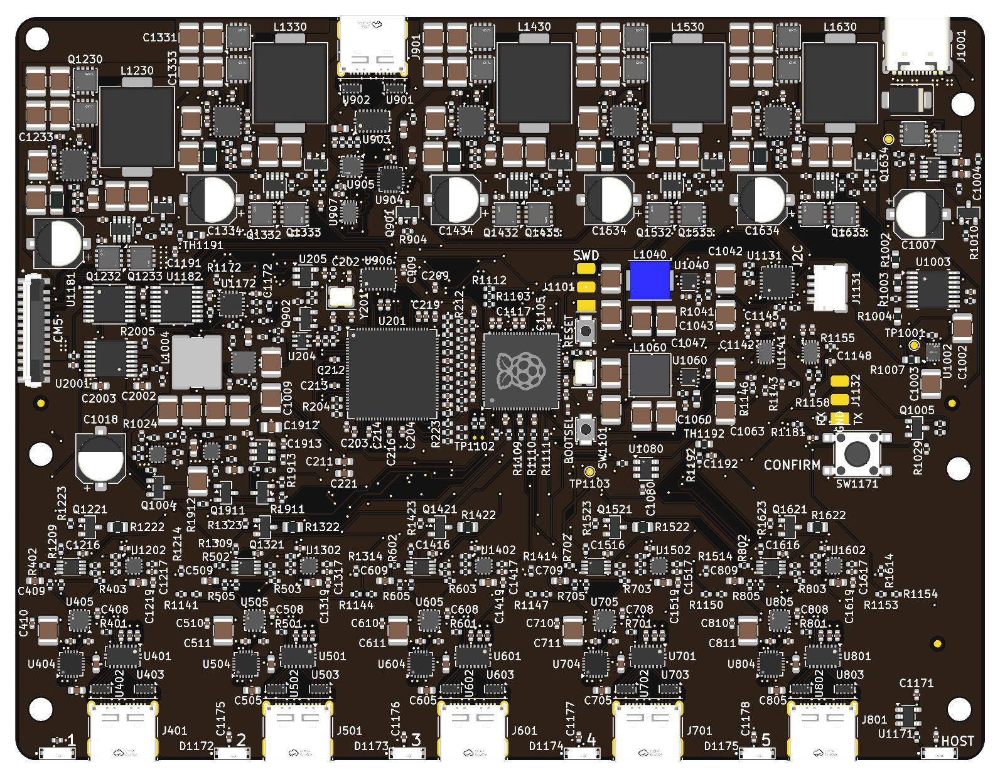

# Iasis board

The main PCB for Iasis. It's the same board whether you're building the basic USB hub, adding USB-C power input (HubPD), or fitting the CM5 carrier. The [root README](../../../README.md#hardware) explains the three assembly variants.



## Project files

The KiCad 10 design includes `iasis.kicad_sch` and its sheets, `iasis.kicad_pcb`, `iasis.kicad_pro` and `iasis.kicad_dru` for the extra rules the normal board setup can't express.

Custom parts are in `../../shared/Iasis.kicad_sym`, `../../shared/Iasis.pretty` and `../../shared/Iasis.3dshapes`, with source and licence details in their `NOTICE` files. The [board tools](../../tools/README.md) handle exports, previews and JLCPCB placement corrections.

## Build and check

Install the [root development tools](../../../README.md#development), including KiCad 10, then run:

```sh
mise run //hardware/boards/iasis:fab
mise run //hardware/boards/iasis:preview
mise run //hardware/boards/iasis:step
mise run //hardware/boards/iasis:lint
```

`fab` writes to `build/boards/iasis/`:

| File                                          | Contents                                             |
| --------------------------------------------- | ---------------------------------------------------- |
| `gerbers.zip`                                 | Gerbers and drill files for the PCB order            |
| `bom-Hub.csv`, `bom-HubPD.csv`, `bom-CM5.csv` | JLCPCB BOM for each assembly variant                 |
| `cpl-Hub.csv`, `cpl-HubPD.csv`, `cpl-CM5.csv` | JLCPCB placements with footprint corrections applied |

The same folder also gets a board/project copy and `bottom.svg`. `step` exports `board.step` for the case tools. `lint` produces `drc.json` and `erc.json` and checks DRC, schematic parity and ERC. Exports use the saved design and include the silkscreen artwork; they don't save changes to the PCB.

`preview` updates the checked-in `board.png`. Commit the image when the board changes. Pass `--output DIR` to change an export directory.

The underside silkscreen contains the name, repository URL and `REV ${REVISION}`, taken from the KiCad title block. All three assembly variants share the same PCB revision. Keep fabrication files with the commit used to manufacture a revision, tagged for example `iasis-rev-a`.

## Ordering from JLCPCB

The board is six layers and 133 × 102 mm. These are the intended JLCPCB settings; check their current options and pricing before ordering.

| Option                      | Setting                 | Note                                                                                         |
| --------------------------- | ----------------------- | -------------------------------------------------------------------------------------------- |
| Board thickness             | 1.6 mm                  | Required for the planned Economic six-layer assembly combination                             |
| Stackup                     | `JLC06161H-3313`        | The 90 Ω pairs use 0.1356 mm tracks and a 0.1501 mm gap. JLC quotes 1.54 mm actual thickness |
| Colour                      | Green                   | Part of the Economic assembly combination                                                    |
| Finish                      | ENIG                    | Avoid the default OSP, which doesn't work with the intended Economic assembly option         |
| Vias                        | Epoxy filled and capped | Some are in pads; listed without an extra charge for six layers                              |
| Minimum via hole / diameter | 0.3 / 0.4–0.45 mm       | 0.2 mm holes bring extra charges and TG155/Kelvin test requirements                          |
| Impedance control           | No requirement          | Paid ±10% control requires production-file confirmation                                      |
| Mark on PCB                 | Remove mark             |                                                                                              |

The `gerbers.zip` contains Gerber and drill files, not the optional Gerber job file. That file's preview colour and impedance metadata don't match these order settings.

For assembly, choose **Economic PCBA**, top side, with JLCPCB tooling holes and customer-selected parts. Enable **Confirm Parts Placement**. JLCPCB automatically confirms after 72 hours unless you tick **Do not confirm automatically**. You can assemble two boards or all five.

Upload `gerbers.zip`, followed by the BOM and CPL for the variant you're building. Before placing the order:

1. Tick the USB-C connector rows (`J1001`, `J401–J901`). JLCPCB leaves these unticked after each upload and charges a small fee for them.
2. Check that every part is matched, stocked and allowed under Economic assembly. If a part is **Standard Only**, change the schematic and regenerate the exports instead of patching the order table.
3. Check **Component Placements**. Parts should line up with their pads, and JLCPCB's **Align** button shouldn't move them. If it does, measure and add a correction in `../../tools/jlc_corrections.csv`.
4. For customs, the closest description is **Research/Education/DIY → Development Board** (HS 847330).

## Placement corrections

JLCPCB uses its EasyEDA footprints, so its origin and rotation can differ from KiCad's. The CPL's Mid X/Y and Rotation need to match the supplier footprint, not just the KiCad placement. `../../tools/jlc_corrections.csv` stores adjustments per LCSC part _and_ KiCad footprint; there's no need to copy every supplier footprint into the project.

For a new part, fetch the EasyEDA footprint from `https://easyeda.com/api/products/<LCSC>/components?version=6.4.19.5`. Pad coordinates use 0.254 mm units, Y points down and the origin is at `dataStr.head`. Match the numbered pads at each quarter-turn and record the rotation and offset that fit. Ordinary two-terminal chip parts don't need a correction.
