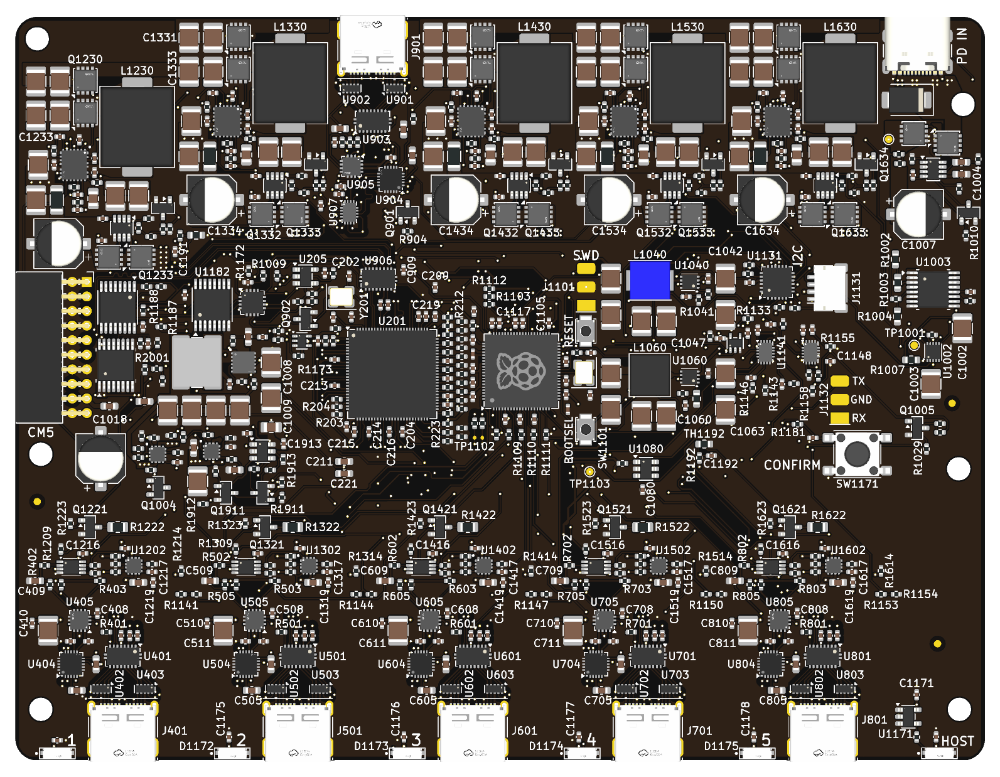

# Iasis board

The main board connects five target USB-C ports to a host and controls their power and DFU signalling. HubPD adds charging supplies and a socket for the optional [CM5 carrier](../cm5/README.md).



## Fabrication files

Install the [development tools](../../../README.md#build), including KiCad 10 and its standard libraries, then run from the repository root:

```sh
mise run //hardware/boards/iasis:lint
mise run //hardware/boards/iasis:fab
```

Outputs go to `build/boards/iasis/`. Both populations use the same `gerbers.zip`:

| Population      | Assembly files               | Includes                                         |
| --------------- | ---------------------------- | ------------------------------------------------ |
| HubPD (default) | `bom.csv`, `cpl.csv`         | Charging supplies, protected CM5 feed and socket |
| Hub             | `bom-Hub.csv`, `cpl-Hub.csv` | Host-powered hub and target presence supplies    |

The CM5 build uses HubPD plus the separate carrier. No main-board component changes are needed.

## JLCPCB order

| Setting           | Value                                         |
| ----------------- | --------------------------------------------- |
| Layers / size     | 6 / 133 × 102 mm                              |
| Thickness         | 1.6 mm; stackup finished thickness 1.54 mm    |
| Stackup           | `JLC06161H-3313`                              |
| Colour / finish   | Green / ENIG                                  |
| Via covering      | Epoxy filled and capped                       |
| Minimum via hole  | 0.3 mm                                        |
| Impedance control | No requirement                                |
| PCB mark          | Remove mark                                   |
| Assembly          | Economic PCBA, top side, JLCPCB tooling holes |
| Parts             | Customer-selected                             |

Keep green, ENIG and 1.6 mm for the six-layer [Economic assembly combination](https://jlcpcb.com/capabilities/pcb-assembly-capabilities). The USB pairs use the specified stackup; do not substitute another one.

Upload `gerbers.zip` and the matching BOM/CPL pair. Before ordering:

1. Select the USB-C connector rows (`J1001`, `J401–J901`); they can be left unchecked after upload.
2. Check part matches, stock and Economic eligibility. Replace unsuitable parts in the schematic and regenerate the exports.
3. Inspect **Component Placements**, including polarity and connector orientation. If **Align** moves a part off its pads, fix the [placement correction](../../tools/README.md#placement-corrections) and export again.
4. Enable **Confirm Parts Placement** and disable automatic confirmation.

## Design files and revisions

Open `iasis.kicad_pro` in KiCad. Shared symbols, footprints and models are in `../../shared`, with their licence notices.

Use `mise run //hardware/boards/iasis:step` for the populated STEP and `:preview` for `board.png`. The [board tools](../../tools/README.md) describe the exports and checks.

The title-block revision appears on the underside silkscreen. Hub and HubPD share it. Tag a fabrication commit as `iasis-rev-a` for Revision A and retain its fabrication package; software versions are separate.
