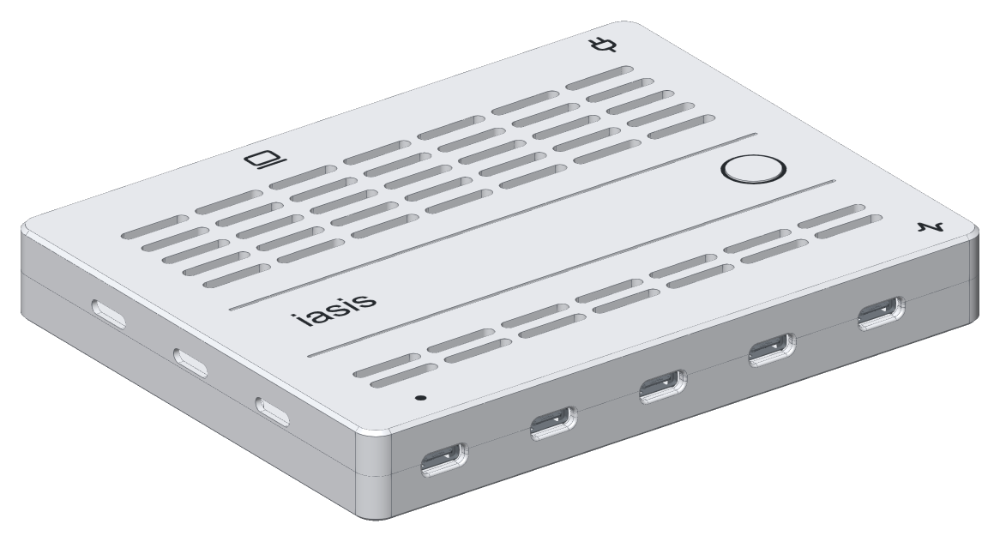
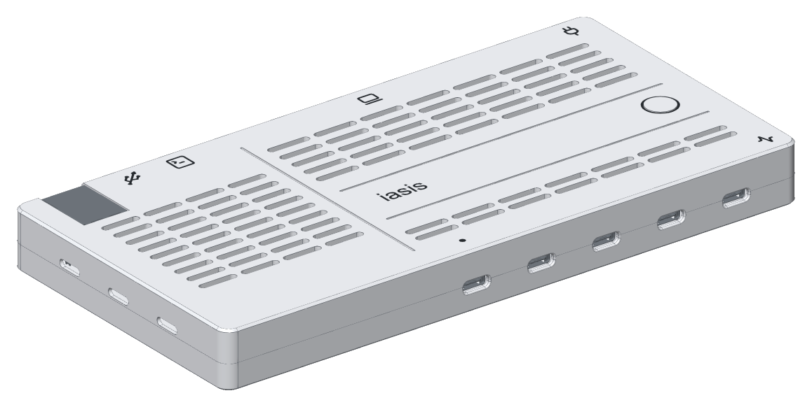

# Iasis case

A printed case with a screw-fastened lid and captive button. Choose a plain lid or one for an Adafruit 938 STEMMA QT OLED. The longer CM5 version holds the main board and carrier together.





| Case                  | Printed body size       |
| --------------------- | ----------------------- |
| Main board, plain lid | 136 × 104.6 × 17.1 mm   |
| Main board, OLED lid  | 136 × 104.6 × 17.6 mm   |
| CM5, plain lid        | 212.6 × 104.6 × 20.1 mm |
| CM5, OLED lid         | 212.6 × 104.6 × 20.1 mm |

## Generate the parts

Install the [development tools](../../README.md#build), including KiCad 10, then run from the repository root:

```sh
mise run //hardware/case:build
```

The build exports both populated boards and writes the case parts to `build/case/iasis/`:

| File                                                    | Part / print orientation                    |
| ------------------------------------------------------- | ------------------------------------------- |
| `print/tray.stl`                                        | Tray, floor down                            |
| `print/cover-passive.stl` / `print/cover-display.stl`   | Lid, top down                               |
| `print/button-passive.stl` / `print/button-display.stl` | Matching button, face down                  |
| `print/cover-*-lettering.stl`                           | Optional aligned lid inlays                 |
| `print/display-pins.stl`                                | Four printed OLED mounting pins             |
| `print/cm5-*.stl`                                       | Corresponding CM5 parts; uses the same feet |
| `iasis-case.step` / `iasis-cm5-case.step`               | Assemblies with both lid options            |

The STLs are already oriented for printing. The STEP assemblies include screw, nut and purchased-foot envelopes; these are not printed parts.

## Hardware

Both sizes use the same hardware.

| Quantity | Part                                       |
| -------- | ------------------------------------------ |
| 4        | M3 × 12 mm pan-head screws and M3 hex nuts |
| 4        | Small self-adhesive rubber feet            |

Use the listed screw lengths to avoid reaching the lid's outer face.

## Print and assemble

Use PLA, a 0.4 mm nozzle, 0.20 mm layers and no supports. For multicolour markings, import the lid and matching lettering STL as parts of one object, retain their positions and assign filaments. Omit the lettering STL for recessed text.

1. Lay the lid face down so it holds the loose parts. Place the button in its hole and slide the nuts into the inward-facing slots in the four outer posts. Fit the [OLED](#oled-assembly) if present.
2. Place the PCB component-side down on the lid posts. Lower the tray so its pegs pass through the board into the lid sockets.
3. Fasten the tray from underneath. Place the feet near the corners, clear of the screw recesses.

Open the case lid-down to keep the button and nuts in place. BOOTSEL and RESET are under the lid.

### OLED assembly

Point the OLED's flex edge toward the target ports. Rest its mounting ears on the four posts and press a printed pin through each corner hole until its head seats against the PCB. Keep pressure on the mounting ears and off the glass. Use whichever STEMMA QT socket the Qwiic cable reaches.

### CM5 assembly

| Cooler fit                          | Dimension                         |
| ----------------------------------- | --------------------------------- |
| Model                               | Waveshare CM4-HEATSINK, SKU 19623 |
| Body                                | 55 × 40 × 5 mm                    |
| Mounting allowance above module PCB | 3 mm                              |

Disconnect power before assembly or removal.

1. Fit the cooler screws from below and check thermal-pad contact with the spacers in place.
2. Stick the RTC battery in the tray recess. Route its cable along the channel and pass the plug between the boards before joining them.
3. Align the boards' rear edges, mate the connector and seat the boards on the tray pegs. Lay the wires side by side in the board gap.
4. Connect the battery to J104. See [RTC battery](../boards/cm5/README.md#rtc-battery) for charging settings.

To remove the battery, unplug J104 and separate the boards before feeding the plug back through the gap.

## CAD tools

The case is generated with build123d. These tasks use the root Python environment:

| Task                                | Purpose                                                     |
| ----------------------------------- | ----------------------------------------------------------- |
| `mise run //hardware/case:test`     | Check solids, board clearances, USB access and moving parts |
| `mise run //hardware/case:preview`  | Refresh the two images; requires a working graphics driver  |
| `mise run //hardware/case:view`     | Open in OCP CAD Viewer                                      |
| `mise run //hardware/case:view-cm5` | Open the CM5 assembly                                       |

In the viewer, show one lid at a time under Cover. The [Lucide icons](src/iasis_case/icons/NOTICE) retain their licence and source notices.
