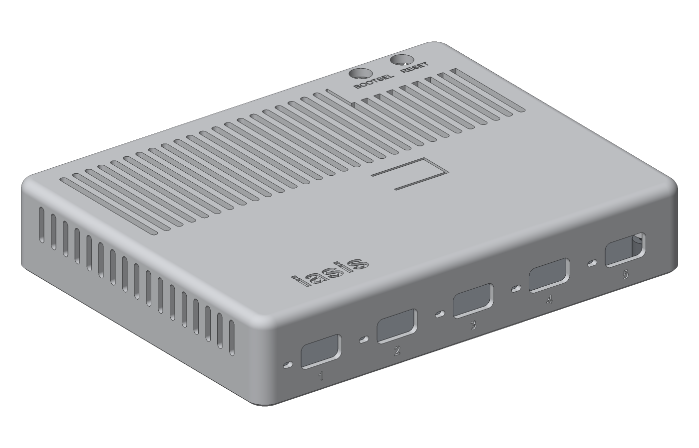
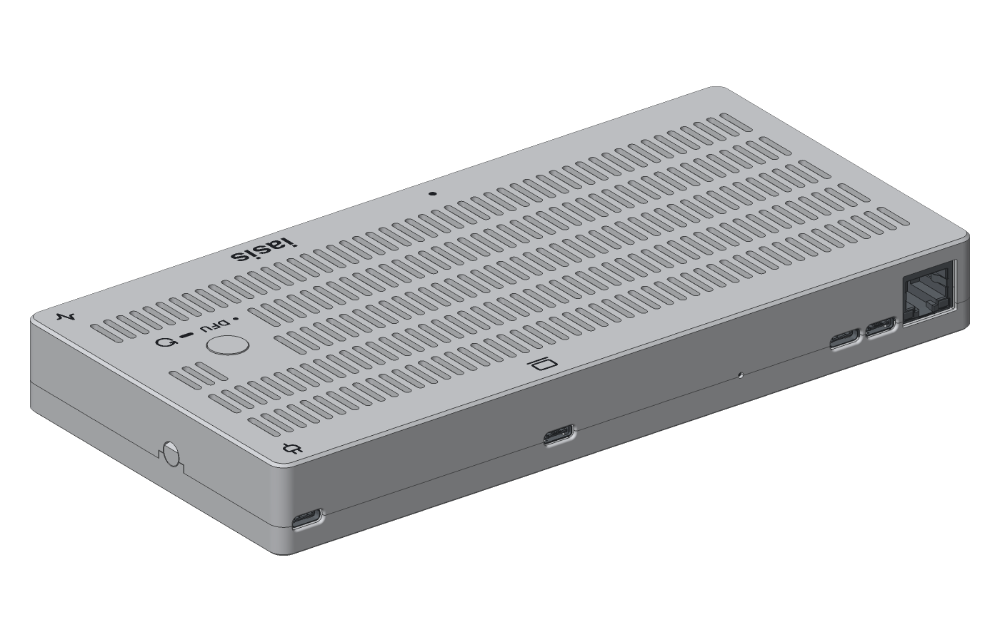

# Iasis case

A screwless 3D-printable enclosure for Iasis, generated with [build123d](https://github.com/gumyr/build123d) from the populated board. Passive and OLED covers share a tray. The bodies measure 136 × 104.6 mm, with heights of 17.1 mm for the passive cover and 19.6 mm for the OLED cover. The button stands another 0.2 mm above the roof. The CM5 build has its own enclosure, one tray and flat cover for the main board and the CM5 side board: 212.6 × 104.6 mm and 20.1 mm high for either cover. The Ethernet socket sits in an open rear notch, approximately flush with the top. The cooler sets the roof height.





## Build

Install the repository's mise tools and KiCad 10, then run:

```bash
mise run //hardware/case:build
```

The task exports the populated boards from `../boards/iasis` and `../boards/cm5`, then writes the case files for both builds to `build/case/iasis/` at the repository root.

| Output                                                          | Contents                                                                         |
| --------------------------------------------------------------- | -------------------------------------------------------------------------------- |
| `build/case/iasis/iasis-case.step`                              | Board and both enclosure variants                                                |
| `build/case/iasis/print/tray.stl`                               | Shared tray with foot recesses, floor down                                       |
| `build/case/iasis/print/tpu-foot.stl`                           | Circular TPU foot, flat bottom down; print four per enclosure                    |
| `build/case/iasis/print/cover-passive.stl`, `cover-display.stl` | Covers, top down, with recessed markings                                         |
| `build/case/iasis/print/cover-*-lettering.stl`                  | Aligned colour fills for the cover markings                                      |
| `build/case/iasis/print/button-*.stl`                           | Matching button caps, face down                                                  |
| `build/case/iasis/print/display-retainer.stl`                   | OLED retaining frame, flat side down                                             |
| `build/case/iasis/iasis-cm5-case.step`                          | Both boards and the CM5 build's enclosure variants                               |
| `build/case/iasis/print/cm5-*.stl`                              | The CM5 build's tray, covers, lettering, buttons and retainer, oriented as above |

Run `mise run //hardware/case:preview` to refresh `preview/case.png` and `preview/case-cm5.png`. Run `mise run //hardware/case:check` to check solid validity, component clearance, USB access and moving parts for both enclosures. Neither is part of the build task.

Use `--output DIR` on `build` or `preview` to change their output directories.

The root Python environment provides `iasis-case-build`, `iasis-case-preview`, `iasis-case-check` and `iasis-case-view`; run them with `uv run --locked` from the repository root or this directory.

## Print and assemble

Use a 0.4 mm nozzle and 0.20 mm layers, without supports. Print the button in the body colour. For multicolour covers, import the cover and its matching lettering STL together as parts of one object, preserving their positions, then assign filaments. Leave the lettering out for recessed markings.

Print four TPU feet separately and secure them with adhesive in the underside recesses. Each foot is 12 mm diameter × 2 mm thick, with a 0.4 mm bottom chamfer. The recesses are 12.4 mm diameter × 0.8 mm deep, leaving 1.2 mm exposed before adhesive thickness. The floor is solid; side inlets above the board and top slot bands provide ventilation. The CM5 side has a rectangular field of nine vent rows above the cooler, separated from the hub controls by a shallow divider groove.

Place the board on the tray pegs, insert the button from inside the cover, and press the cover down until both end catches engage. To open, press the two round end-wall pads inward and lift the cover vertically.

The OLED cover accepts an Adafruit 938 STEMMA QT display. Seat it on the cover's locating pins, slip the retaining frame into the two rear keepers, then press its front edge into the finger catch. To remove it, push the finger pad inward, lift the front edge and slide the frame out. Connect a Qwiic cable before closing the case, keeping the lead clear of the button and catches.

The CM5 build's enclosure holds both boards on its tray pegs, the side board's RJ45, accessory and service USB-C ports and nRPIBOOT pinhole in the rear wall beside the host and power ports.

The specified cooler is the [Waveshare CM4-HEATSINK, SKU 19623](https://www.waveshare.com/cm4-heatsink.htm), Amazon ASIN B093FSS6XX: a 55 × 40 × 5 mm body with a provisional 3 mm mounting allowance above the module PCB.

The cooler envelope reaches 12.21 mm above the carrier board underside. The inner roof is at 13.5 mm, leaving 1.29 mm above it; the 1.6 mm roof and 5 mm underside-to-base stack give the 20.1 mm body height. The Ethernet shell reaches 15.05 mm, approximately 0.05 mm below the top face at 15.1 mm. A taller spacer stack would require more case height. Lowering the lid further to expose more Ethernet would reduce the cooler clearance.

Verify the supplied standoffs and thermal-pad contact with the CM5 before assembly; the clearance model does not establish thermal performance. Fit the cooler's screws from below before seating the side board, then fit the side-link flex into both vertical connectors, contacts toward the gap, and close their actuators, with the cover removed.

A dot marks target port 1; laptop and plug icons identify host and power. The activity icon marks the Iasis status LED. Lucide USB and terminal icons identify the CM5 accessory and service ports; Ethernet has no top label. The action labels use 4.5 mm bold type, with approximately 3.3 mm capital height. The three button rows have right-aligned text and centred gesture marks beside the button:

| Mark               | Gesture               | Action                   |
| ------------------ | --------------------- | ------------------------ |
| Dot                | Click                 | DFU                      |
| Bar                | Hold                  | Reboot connected targets |
| Two dots and a bar | Two clicks, then hold | Restore                  |

These are intended actions; firmware and host restore handling are not yet implemented. Remove the cover to reach BOOTSEL and RESET.

## Viewer

`mise run //hardware/case:preview` renders PNGs and exits. It uses pygfx's offscreen WebGPU renderer, reports geometry and rendering phases for each case and skips unchanged inputs. A working graphics driver is required. Use `mise run --force //hardware/case:preview` to regenerate the images. Only the following `view` tasks connect to OCP CAD Viewer.

Run `mise run //hardware/case:view` with [OCP CAD Viewer](https://marketplace.visualstudio.com/items?itemName=bernhard-42.ocp-cad-viewer) to show Tray, PCB and Cover layers. Both cover variants are under Cover, the OLED one hidden; show one at a time. Run `mise run //hardware/case:view-cm5` for the CM5 build.

Use the repository root's `.venv`, configured in `.vscode/settings.json`. Update the viewer library with `uv lock --upgrade-package ocp-vscode` when the extension requires a newer version.

Icons are from [Lucide](https://lucide.dev/); source SVGs and licences are in `src/iasis_case/icons/`. Verify cable fit, button movement and latch operation on a physical print.
