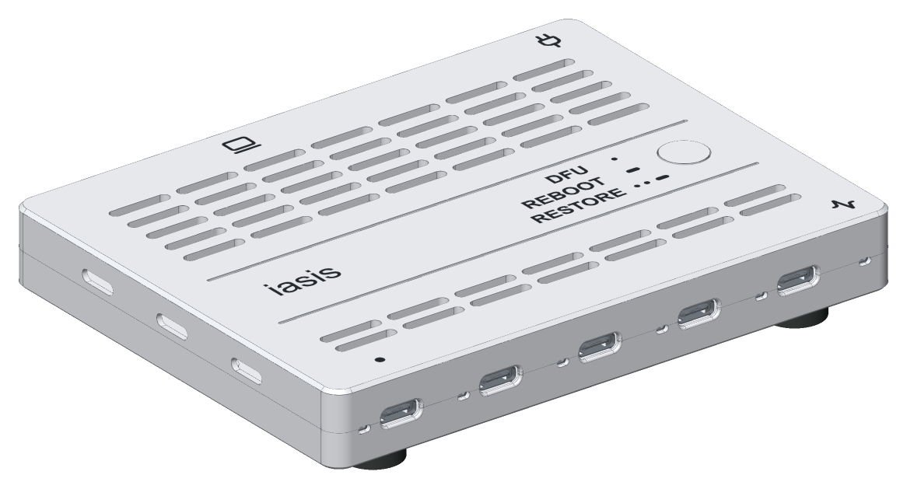
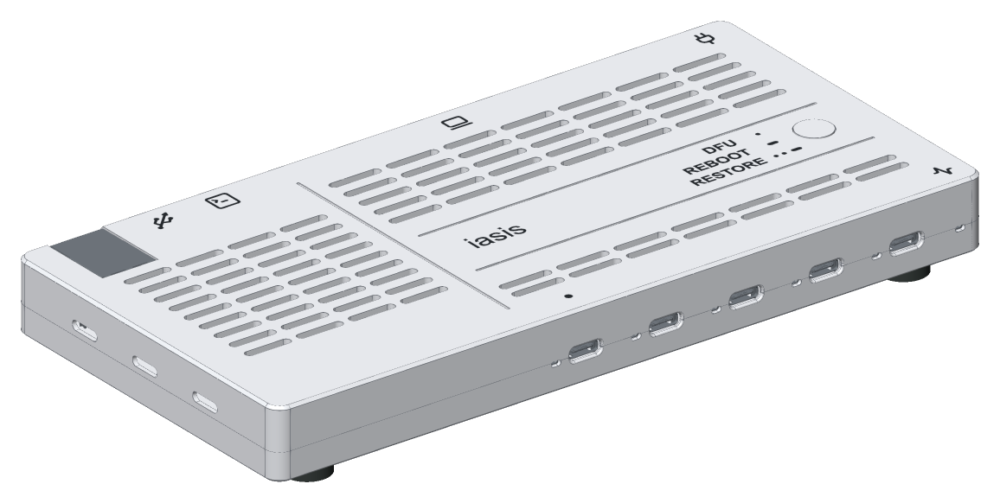

# Iasis case

A snap-fit printed case with a removable lid and captive button. Choose a plain lid or one for an Adafruit 938 STEMMA QT OLED. The longer CM5 version holds the main board and carrier together.





| Case                  | External size, excluding feet |
| --------------------- | ----------------------------- |
| Main board, plain lid | 136 × 104.6 × 17.1 mm         |
| Main board, OLED lid  | 136 × 104.6 × 19.6 mm         |
| CM5, either lid       | 212.6 × 104.6 × 20.1 mm       |

## Generate the parts

Install the [development tools](../../README.md#build), including KiCad 10, then run from the repository root:

```sh
mise run //hardware/case:build
```

The build exports both populated boards and writes the case parts to `build/case/iasis/`:

| File                                                    | Part / print orientation                    |
| ------------------------------------------------------- | ------------------------------------------- |
| `print/tray.stl`                                        | Tray, floor down                            |
| `print/cover-passive.stl` / `print/cover-display.stl`   | Lid, top down                               |
| `print/button-passive.stl` / `print/button-display.stl` | Matching button, face down                  |
| `print/display-retainer.stl`                            | OLED frame, flat side down                  |
| `print/tpu-foot.stl`                                    | Foot, flat side down; print four            |
| `print/cover-*-lettering.stl`                           | Optional aligned lid inlays                 |
| `print/cm5-*.stl`                                       | Corresponding CM5 parts; uses the same feet |
| `iasis-case.step` / `iasis-cm5-case.step`               | Assemblies with both lid options            |

The STLs are already oriented for printing.

## Print and assemble

Use PLA, a 0.4 mm nozzle, 0.20 mm layers and no supports. Print the feet in TPU. For multicolour markings, import the lid and matching lettering STL as parts of one object, retain their positions and assign filaments. Omit the lettering STL for recessed text.

1. Glue the four feet into the tray recesses.
2. Set the PCB on the locating pegs.
3. Fit the button from inside the lid.
4. Press the lid down until both catches engage.

To open, squeeze the round pads at either end and lift the lid straight up. BOOTSEL and RESET are under the lid. The dot marks port 1; [button gestures](../../README.md#use) are printed beside the button.

### OLED assembly

Place the display on the lid's locating pins. Slide the retaining frame under the two rear keepers, then snap its front edge into the catch. Connect the Qwiic cable before closing, clear of the button and catches.

To remove the frame, press its finger pad inward, lift the front and slide it out.

### CM5 assembly

| Cooler fit                          | Dimension                         |
| ----------------------------------- | --------------------------------- |
| Model                               | Waveshare CM4-HEATSINK, SKU 19623 |
| Body                                | 55 × 40 × 5 mm                    |
| Mounting allowance above module PCB | 3 mm                              |

Check the cooler's spacers and thermal-pad contact before assembly. Taller spacers need a taller lid.

Disconnect power before assembly or removal.

1. Fit the cooler screws from below.
2. Stick the RTC battery into the tray recess. Route its cable along the channel and pass the plug between the boards before joining them.
3. Align the boards' rear edges and connector pins, join the boards and lower them onto the pegs. Keep the wires side by side in the board gap.
4. Connect the battery to J104, tuck the cable clear of the lid and [enable charging](../boards/cm5/README.md#rtc-battery).

To remove the battery, unplug J104 and separate the boards before feeding the plug back through the gap.

## CAD tools

The case is generated with build123d. These tasks use the root Python environment:

| Task                                | Purpose                                                     |
| ----------------------------------- | ----------------------------------------------------------- |
| `mise run //hardware/case:test`     | Check solids, board clearances, USB access and moving parts |
| `mise run //hardware/case:preview`  | Refresh the two images; requires a working graphics driver  |
| `mise run //hardware/case:view`     | Open in OCP CAD Viewer                                      |
| `mise run //hardware/case:view-cm5` | Open the CM5 assembly                                       |

In the viewer, show one lid at a time under Cover. The [Lucide icons](src/iasis_case/icons/NOTICE) retain their licence and source notices.
