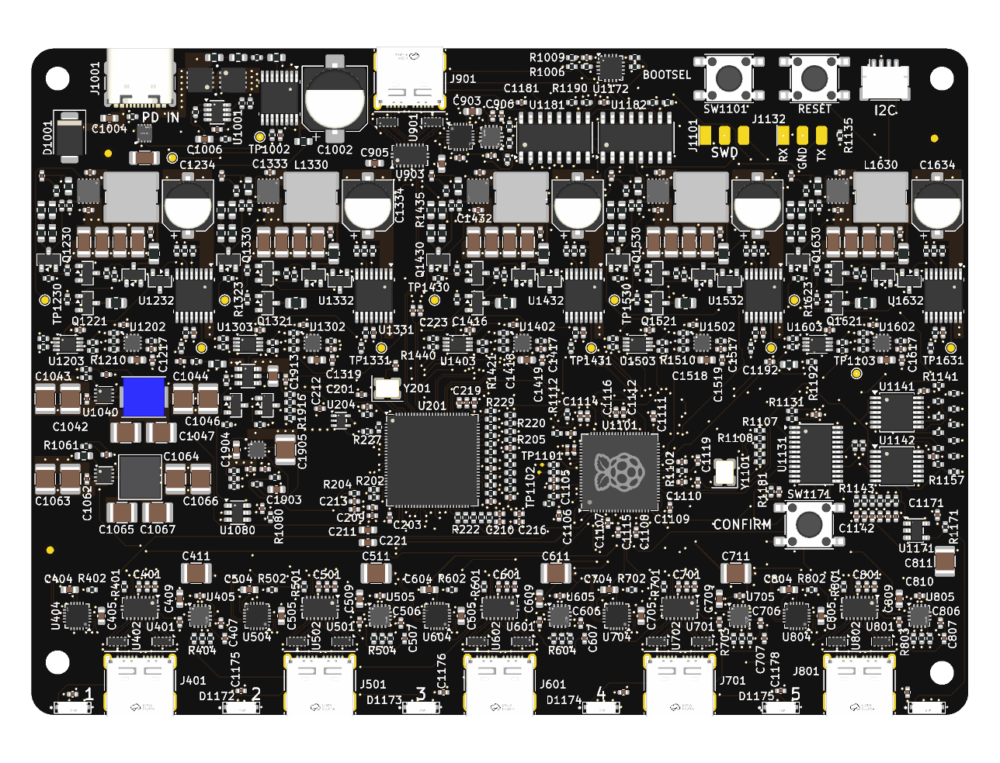
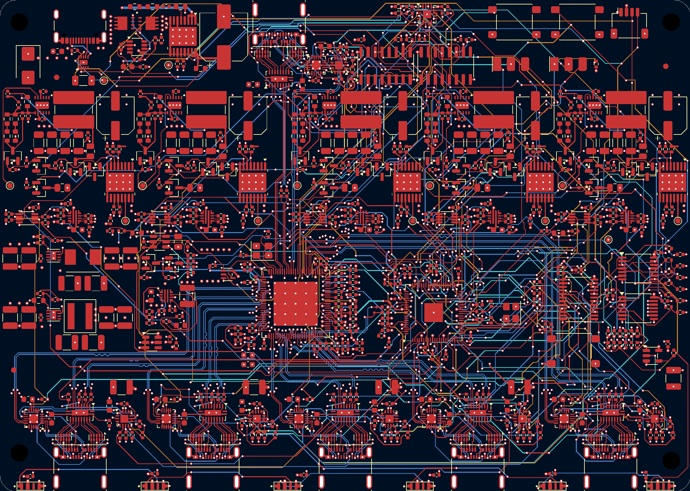

# Iasis board

KiCad 10 project for the six-layer, 125 × 89 mm Iasis board. One layout carries two assembly variants, Hub and HubPD; the [repository README](../../README.md) describes them.

 

## Files

- `iasis.kicad_sch` and its sheets, `iasis.kicad_pcb`, `iasis.kicad_pro`, and `iasis.kicad_dru` for the rules the board setup cannot express.
- `Iasis.kicad_sym`, `Iasis.pretty` and `Iasis.3dshapes`: project symbols, footprints and models. `NOTICE` files give their sources and licences.
- `jlc_cpl.py` corrects placements for JLCPCB (below); `preview.py` writes `preview/board.png` and `preview/layout.png`; `diff.py` shows a board change (below).

## Fab files

Tools come from mise (`mise install` at the repository root); KiCad 10 must be at the path `KICAD_CLI` names in `.mise/config.toml`.

```bash
mise run //hardware/iasis:fab
```

The task first runs `preview`, which renders the HubPD top side into `preview/board.png` and plots every copper layer's tracks and pads, without zone fills, and the top silkscreen's outlines into `preview/layout.png`, then rewrites `build/`:

| File                           | Contents                                                  |
| ------------------------------ | --------------------------------------------------------- |
| `gerbers.zip`                  | Gerber and drill files                                    |
| `bom-Hub.csv`, `bom-HubPD.csv` | Bill of materials per variant, one row per LCSC part      |
| `cpl-Hub.csv`, `cpl-HubPD.csv` | Placements per variant, corrected for JLCPCB's footprints |

Both previews are tracked so that history shows how the board changes; commit them with the change that moved them. A preview is rewritten only when its content changes. The layout, rasterised by resvg and packed by oxipng (both from mise), repeats byte for byte; the render differs by a few bytes between runs of an unchanged board, so it is replaced only when more than that changes.

The upload ZIP contains Gerber and drill files. It excludes the optional Gerber job file, whose board-preview colour and impedance-control metadata differ from the order settings below.

## Visual diff

```bash
mise run //hardware/iasis:diff
```

compares the last commit's board with the working copy; `diff REV` compares a revision with the working copy, and `diff OLD NEW` two revisions. The task plots each copper, silkscreen and courtyard layer and the outline of both boards, without zone fills, and draws what was removed red, what was added green and the rest grey. It opens `build/diff/index.html`, which pans and zooms each layer and counts the tracks, vias and footprints that changed.

## JLCPCB order

PCB options:

| Option                  | Setting                 | Reason                                                                                                        |
| ----------------------- | ----------------------- | ------------------------------------------------------------------------------------------------------------- |
| Layers, size            | 6, 125 × 89 mm          |                                                                                                               |
| Thickness               | 1.6 mm                  | Economic assembly of six layers needs 1.6 mm, green and ENIG                                                  |
| Specify stackup         | JLC06161H-3313          | The 90 Ω pairs (0.1356 mm tracks, 0.1501 mm gap) are sized for it; accept JLC's 1.54 mm actual thickness note |
| Colour                  | Green                   | As thickness                                                                                                  |
| Surface finish          | ENIG                    | As thickness; JLC offers no HASL on six layers                                                                |
| Via covering            | Epoxy filled and capped | No charge on six layers; some vias sit in pads                                                                |
| Min via hole / diameter | 0.3 / (0.4/0.45) mm     | No hole is smaller; 0.2 mm holes add a small-via charge and force TG155 and a 4-wire Kelvin test              |
| Impedance control       | No requirement          | ±10 % control adds a charge and requires production-file confirmation                                         |
| Mark on PCB             | Remove mark             |                                                                                                               |

Assembly options: Economic PCBA, top side, tooling holes added by JLCPCB, Confirm Parts Placement on, parts selected by customer. PCBA quantity can be 2 or all 5 boards.

Upload `gerbers.zip`, then the variant's BOM and CPL, and:

1. Tick the USB-C rows (J1001, J401–J901). JLC charges a small fee for these parts and leaves them unticked after every upload.
2. Check every row is matched and in stock. Replace a short part in the schematic and regenerate the files, rather than in JLC's table, so the BOM here stays the order's source.
3. In Component Placements, every part should sit on its pads, and JLC's Align should change nothing. A part that Align turns or moves needs an entry in `jlc_cpl.py`.
4. The closest customs description is Research/Education/DIY, Development Board (HS 847330).

## Placement corrections

JLCPCB places its own (EasyEDA) footprint for each LCSC part, with its origin at the CPL's Mid X/Y and turned by Rotation. `jlc_cpl.py` holds, by LCSC code, the turn to add and the EasyEDA origin's position in the KiCad footprint, wherever the two footprints differ.

For a new part, fetch its EasyEDA footprint from `https://easyeda.com/api/products/<LCSC>/components?version=6.4.19.5` (pads in 0.254 mm units, y down, origin at `dataStr.head`). Match its pads to the KiCad pads by number at each quarter turn, then record the turn and origin that fit. Two-terminal chip parts need no entry.
