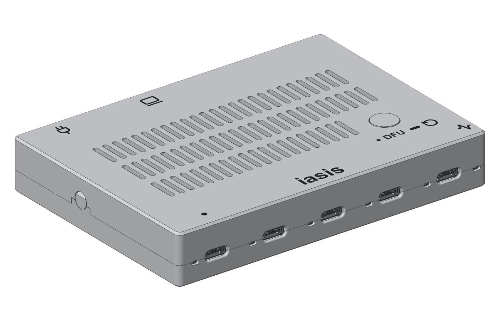

# Iasis case

A screwless 3D-printable enclosure for Iasis, generated with [build123d](https://github.com/gumyr/build123d) from the populated board. Passive and OLED covers share a tray. Both bodies measure 128 × 91.6 × 20.1 mm.



## Build

Install the repository's mise tools and KiCad 10, then run:

```bash
mise run //hardware/lite/case:build
```

The task exports the populated board from `../pcb`, then writes the case files to `build/`.

| Output | Contents |
| --- | --- |
| `build/iasis-case.step` | Board and both enclosure variants |
| `build/print/tray.stl` | Shared tray, floor down |
| `build/print/cover-passive.stl`, `cover-display.stl` | Covers, top down, with recessed markings |
| `build/print/cover-*-lettering.stl` | Aligned colour fills for the cover markings |
| `build/print/button-*.stl` | Matching button caps, face down |
| `build/print/display-retainer.stl` | OLED retaining frame, flat side down |

Run `mise run //hardware/lite/case:preview` to refresh `preview/case.png`. Run `mise run //hardware/lite/case:check` to check solid validity, component clearance, USB access and moving parts. Neither is part of the build task.

To place a logo beside the name, supply a filled SVG:

```bash
mise run //hardware/lite/case:build -- --logo ../../../logos/logo.svg
```

The logo fits within 20 × 10.8 mm, with a 1.8 mm gap before the name; the pair is centred together. Both covers include it in the engraving and lettering STLs. Use filled paths with text and strokes converted to paths. Without `--logo`, only the name is used. The root `logos/` directory holds local SVG inputs and ignores them by default; any other path also works.

The `preview`, `check` and `view` tasks accept the same `--logo` option. Use `--output DIR` on `build` or `preview` to change their output directories.

## Print and assemble

Use a 0.4 mm nozzle and 0.20 mm layers, without supports. Print the button in the body colour. For multicolour covers, import the cover and its matching lettering STL together as parts of one object, preserving their positions, then assign filaments. Leave the lettering out for recessed markings.

Place the board on the tray pegs, insert the button from inside the cover, and press the cover down until both end catches engage. To open, press the two round end-wall pads inward and lift the cover vertically.

The OLED cover accepts an Adafruit 938 STEMMA QT display. Seat it on the cover's locating pins, slip the retaining frame into the two rear keepers, then press its front edge into the finger catch. To remove it, push the finger pad inward, lift the front edge and slide the frame out. Connect a Qwiic cable before closing the case, keeping the lead clear of the button and catches.

A dot marks target port 1; laptop and plug icons identify host and power. The button legend denotes a click for DFU and a hold to reboot connected targets. Firmware is not yet implemented. Remove the cover to reach BOOTSEL and RESET.

## Viewer

Run `mise run //hardware/lite/case:view` with [OCP CAD Viewer](https://marketplace.visualstudio.com/items?itemName=bernhard-42.ocp-cad-viewer) to show Tray, PCB and Cover layers. Both cover variants are under Cover; show one at a time. Add `-- display` to start with the OLED cover visible.

The viewer also accepts `--logo /path/to/case.svg`.

Use this directory's `.venv`, configured in `.vscode/settings.json`. Update the viewer library with `uv lock --upgrade-package ocp-vscode` when the extension requires a newer version.

Icons are from [Lucide](https://lucide.dev/); source SVGs and licences are in `icons/`. Verify cable fit, button movement and latch operation on a physical print.
